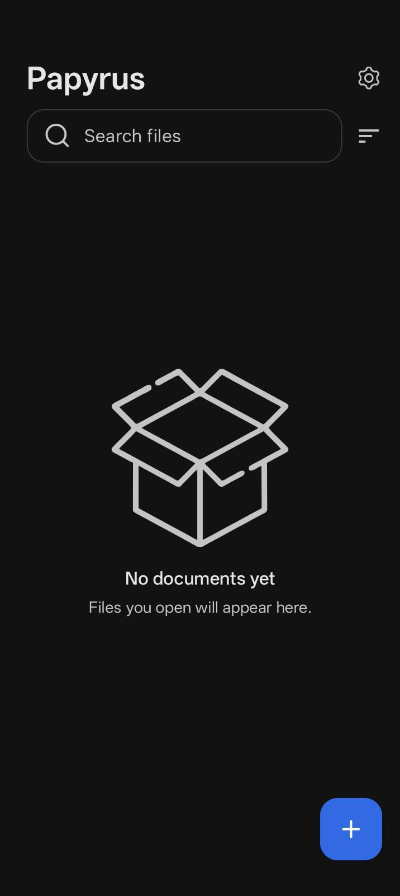
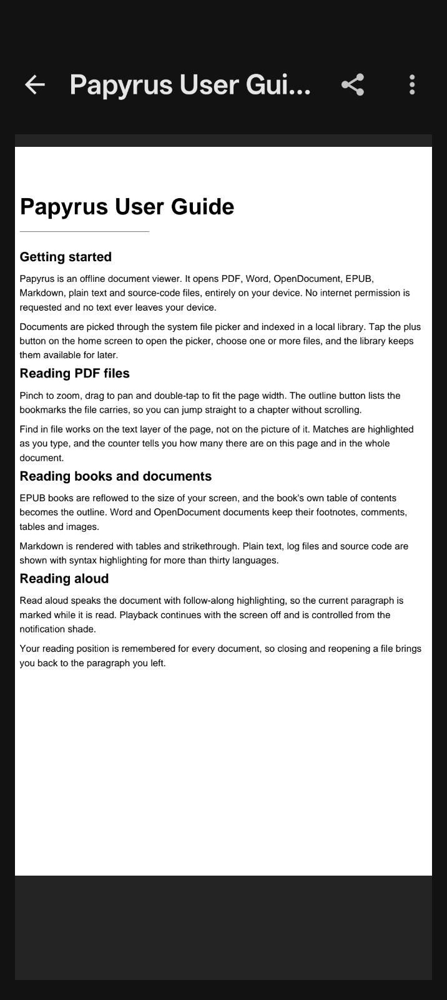
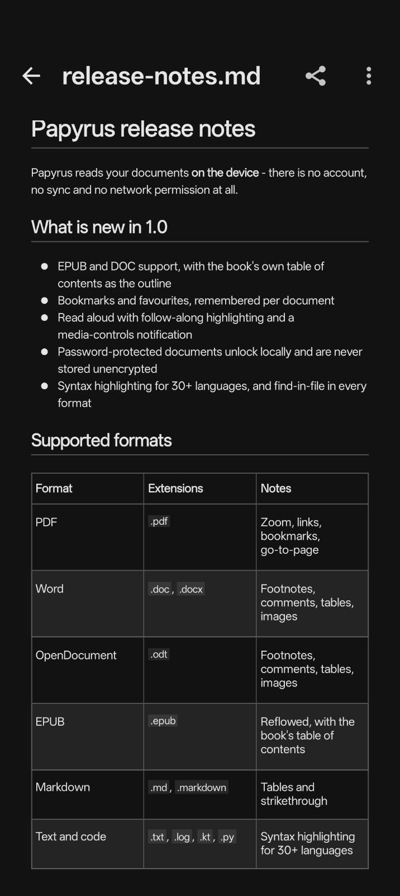
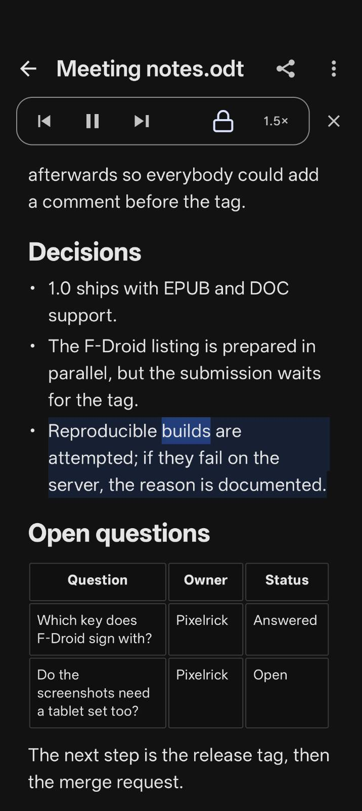

  

<h1 align="center">Papyrus</h1>

  <em>Offline document viewer for Android: PDF, Word, OpenDocument, EPUB, PowerPoint, Markdown, text, code and CSV/TSV.</em> 
  No internet permission. No ads. No accounts. No analytics.

  
  
  
  

  <a href="https://github.com/Pixelrick420/Papyrus/releases/latest"><b>Download the latest APK</b></a> ·
  <a href="#install">Install guide</a> ·
  <a href="docs/SCREENSHOTS.md">All screenshots</a>

  <a href="#screenshots">Screenshots</a> ·
  <a href="#formats">Formats</a> ·
  <a href="#features">Features</a> ·
  <a href="#install">Install</a> ·
  <a href="#development">Development</a>

## Screenshots

<table>
  <tr>
    <td align="center" valign="top"> <b>Library</b> search, sort &amp; filter, starred files</td>
    <td align="center" valign="top"> <b>PDF</b> zoom, links, outline, go to page</td>
    <td align="center" valign="top"> <b>Markdown</b> tables, task lists, maths, code</td>
    <td align="center" valign="top"> <b>Read aloud</b> sentence and word highlighting</td>
  </tr>
</table>

More Screenshots: [docs/SCREENSHOTS.md](docs/SCREENSHOTS.md).

## Formats

| Format            | What you get                                                                                                  |
| ----------------- | ------------------------------------------------------------------------------------------------------------- |
| **PDF**           | Zoom, links, **Outline**, **Go to page**, text selection, highlights and notes, form filling, password unlock |
| **DOCX / ODT**    | Headings, lists, tables, images, footnotes, reviewer comments, DOCX equations as text                         |
| **DOC**           | Paragraphs and tables                                                                                         |
| **EPUB**          | A reflowed book, its own table of contents as the **Outline**, its cover as the thumbnail                     |
| **PowerPoint**    | Slides from PPTX, PPTM, POTX, POTM, PPSX and PPSM                                                             |
| **Markdown**      | Tables, task lists, maths, footnotes, autolinks, coloured code fences, `data:` URI images                     |
| **Text / Logs**   | Fixed-size chunks, selectable text, optional line numbers, no-wrap mode, hyphenated prose                     |
| **Code / Config** | The same text pipeline, with syntax colour for many languages, found by name or by content                    |
| **CSV / TSV**     | A header row in bold, wrapping cells, sideways scroll for wide tables                                         |

The format comes from the file extension first, then the MIME type, then a short content sniff. Text encodings are
detected automatically and can be changed from the viewer menu. A source file's language comes from its name too; only
when the name cannot place it (an unknown or missing extension, or `.h` and `.m`) is the start of the file read, for a
shebang, an XML root, JSON or Objective-C.

## Features

### Library

- **Search** filters by title as you type and looks inside documents too, showing a highlighted excerpt on a content
  match.
- **Sort & filter** in one sheet: last opened, name, date added or size, file-type filters, starred files, a badge for
  what is on and a live match count.
- **Star** files, keep a thumbnail for every document, and **bulk select** to share or remove with progress and Undo.
- **Two panes** on tablets and foldables, with the open row highlighted and the list's scroll and search untouched.
- **Share** sends a read-only grant, and **Remove** never touches your file on disk.
- **File info**: name, format, size, provider type, page or slide count, timestamps and the content URI.

### Reading

- **Find in file** (Ctrl+F) in every format, with the current match highlighted.
- **PDF outline and go to page** (Ctrl+G), plus **Go to line** in long text and code.
- **Bookmarks** (Ctrl+D), named or positional, in every format.
- **PDF selection, highlights and notes**, kept in Papyrus, with **Save highlighted copy** for a new PDF.
- **PDF form fields**, edited in the open document and saved to a copy through the system picker.
- **Reading position** restored with the same zoom, even after a rotation.
- **Read aloud** with sentence and word highlighting and playback with the screen off.
- **Zoom**, and links that open `http`, `https`, `mailto` and `tel`.
- **PowerPoint** slides with text, tables, shapes, pictures, charts, SmartArt, WordArt and effects.

### Settings

- **Theme**, **Colorblind mode** and **Night mode** for pages and slide bitmaps.
- **Syntax highlighting**, **line numbers**, **wrap**, **hyphenation**, **pretty print** and **tab size** for text.
- **Autosave external docs**, **Autosave encrypted docs** and **Remember reading position**.
- **Search inside documents** indexes in the background; **Crash Reports** keeps ACRA logs on-device.
- **About** links to release notes, source, the license and the privacy policy.

### Accessibility

TalkBack-first: each control is one focus stop that says what it is and what a tap does, headings are headings, live
counters announce changes without moving focus, and touch targets meet 48dp. The manual script and the contract
enforced by `AccessibilitySemanticsTest` are in [ACCESSIBILITY.md](ACCESSIBILITY.md).

### Privacy

Papyrus declares no network permission and sends nothing off the device; its index, highlights, notes and crash logs
stay in app storage. The full policy is [PRIVACY_POLICY.md](PRIVACY_POLICY.md).

Detailed feature notes are in [docs/FEATURES.md](docs/FEATURES.md) and every setting in
[docs/SETTINGS.md](docs/SETTINGS.md).

## Install

1. Download the signed APK that fits your phone from the
   [latest release](https://github.com/Pixelrick420/Papyrus/releases/latest): `app-arm64-v8a-release.apk` for most
   phones, `app-armeabi-v7a-release.apk` for older 32-bit ARM ones, or `app-universal-release.apk` if unsure or on an
   x86_64 device.
2. Install it; Android may ask you to allow installs from your browser or file manager.
3. Open a document from Papyrus, or tap one in another app and choose Papyrus.

Needs Android 8.0 or newer. No Play Services, no network permission, no account.

## Development

Needs JDK 17 and the Android SDK, as pinned in `.github/workflows/build.yml`.

| Task                            | What it does                                     |
| ------------------------------- | ------------------------------------------------ |
| `./gradlew assembleDebug`       | build the debug APKs                             |
| `./gradlew installLocalDebug`   | build and install on the connected device        |
| `./gradlew installLocalRelease` | minified release build, signed for local install |
| `./gradlew check`               | unit tests, lint and detekt                      |

Both install tasks use the universal APK. `installLocalRelease` signs a throwaway copy with the local debug keystore,
because the `release` build type is unsigned unless all four `PAPYRUS_*` signing properties are supplied. The build
fails outright if any configuration resolves a Google Play Services, Firebase, ML Kit, Play or data-transport
dependency, so F-Droid compliance is enforced rather than documented.

Test commands, the emulator suite and CI detail: [docs/TESTING.md](docs/TESTING.md). Release, tag and signing rules:
[docs/RELEASING.md](docs/RELEASING.md).

## Known limitations

- **PowerPoint** slides cover text, tables, shapes, pictures, charts, SmartArt, WordArt and effects; speaker notes are
  not shown, EMF+ pictures show a placeholder, and 3-D effects stay flat ([details](docs/LIMITATIONS.md#powerpoint)).
- **DOC** files carry paragraphs and tables only: no images, and headings arrive as plain paragraphs. Encrypted and
  Word 6/95 files are rejected.
- **EPUB** fixed-layout books keep page boundaries and page-sized pictures, but absolutely positioned text reflows;
  styles are read for bold, italic and alignment only, and SVG support is a straight-shape subset.
- **Password-protected** files open only as PDF, `.docx` (ECMA-376 Agile) or `.odt` (ODF 1.2 AES-256-CBC); newer ODF
  1.3 and legacy binary schemes are reported but not opened.
- **PDF form fields** need Android 12 or newer with the PDF SDK form extension, and saving highlights into a copy needs
  a newer extension; XFA forms cannot be filled and signature fields cannot be signed.
- **PDF notes** stay in Papyrus; a saved copy carries plain highlights only. A PDF over 128 MB is not read for an
  outline, though a cached one is still shown.
- **Markdown** shows an image only as a `data:` URI, since the app never touches the network; every other image falls
  back to its alt text.
- **CSV and TSV** tables are not read aloud.
- **Content search** only finds indexed text: encrypted and DRM-protected files and those over the 64 MB source cap
  are not indexed, a document is indexed only up to 1,000,000 characters, and a scanned PDF with no text layer is
  indexed as empty.
- **Size caps**: Markdown is read up to 6 MB, a CSV/TSV up to 8 MB with at most 200,000 cells and 1,024 columns, and a
  UTF-16 or multi-byte text file is held in memory and cut at a cap.

Per-format caveats, including the EPUB, PDF and search detail behind these lines, are in
[docs/LIMITATIONS.md](docs/LIMITATIONS.md).

## Architecture

Documents arrive from the file picker or another app, are identified by extension, MIME type and a short content
sniff, and open in a viewer that renders entirely on-device. Picked files join a Room-backed library with reading
positions, bookmarks, highlights and a full-text index; documents handed over by another app join only when
**Autosave external docs** is on. Read aloud reuses the text the viewer already extracted. The flowchart, schema
diagram and search-indexer detail are in [docs/ARCHITECTURE.md](docs/ARCHITECTURE.md).

## Website

`web/` is the SvelteKit + Tailwind landing page, built to static files and shipped separately from the app. pnpm
commands, pinned versions and CI detail are in [web/README.md](web/README.md).

## Contributing

Issues and pull requests are welcome. See [CONTRIBUTING.md](CONTRIBUTING.md) for the checks to run, the licensing rules
for the PPTX feature, and the accessibility and testing guides.

## License

[Apache-2.0](LICENSE)

Third-party components bundled with the app are listed in [NOTICE](NOTICE).
