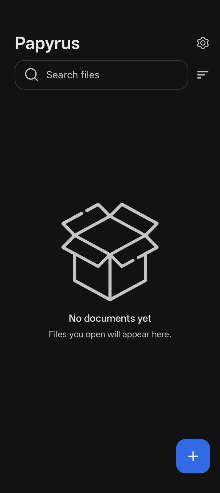
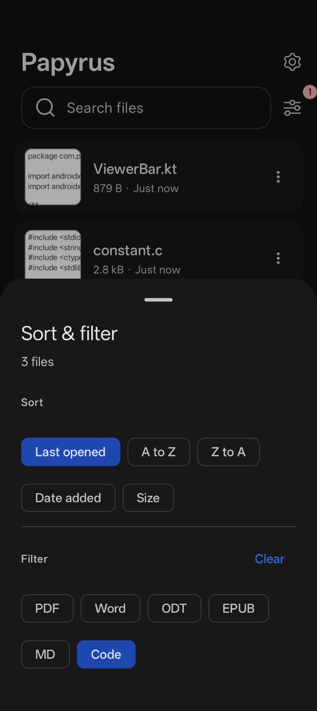
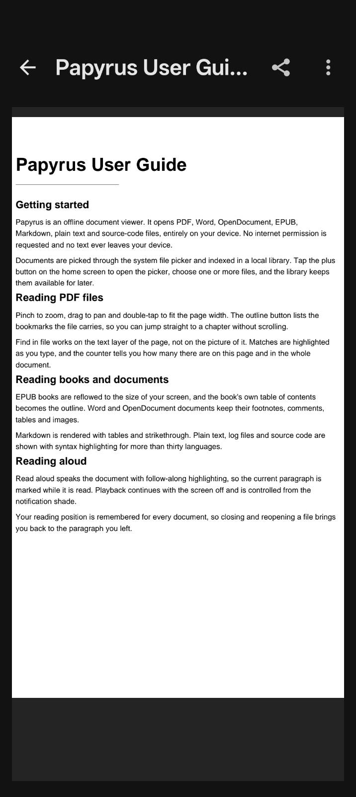
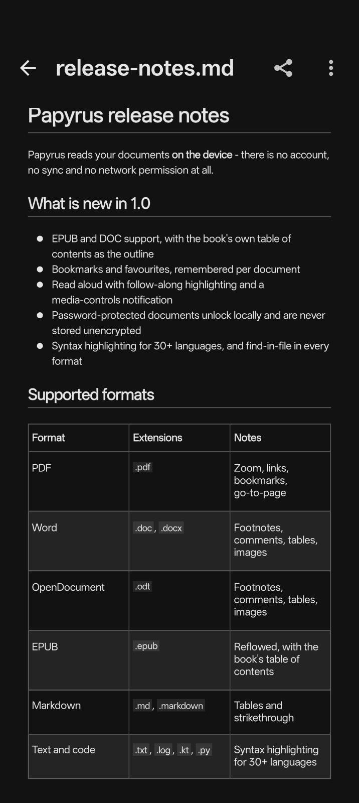
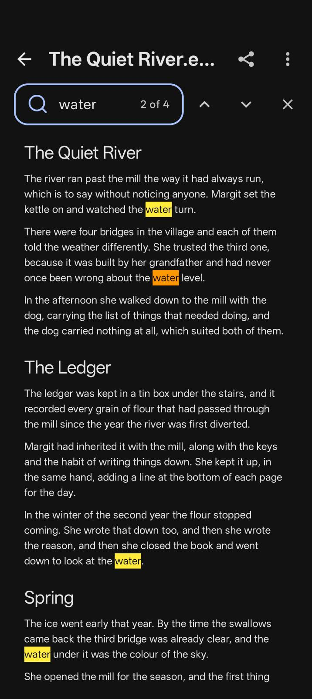
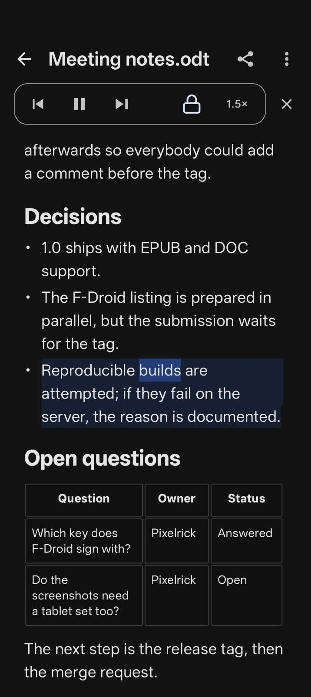
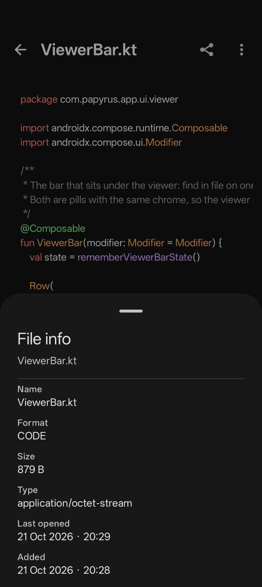
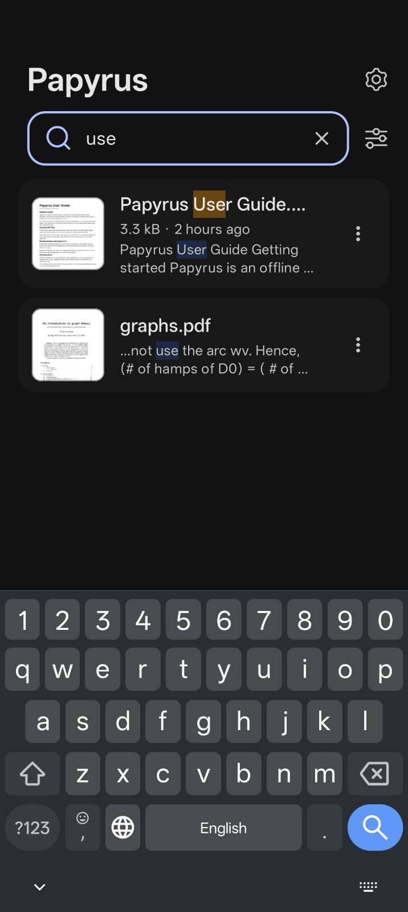
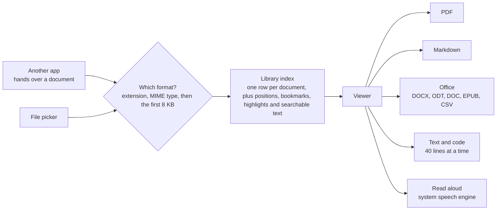
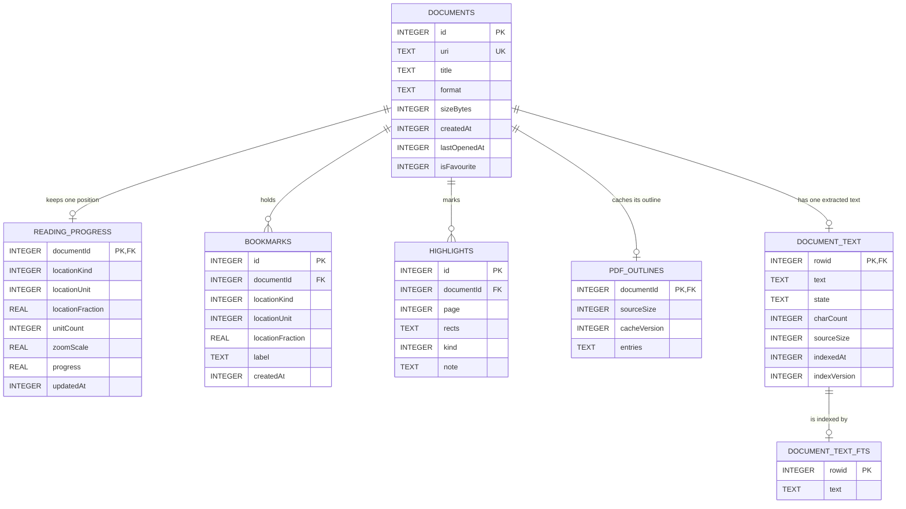

  

<h1 align="center">Papyrus</h1>

  <em>Offline document viewer for Android: PDF, Word, OpenDocument, EPUB, Markdown, text and code.</em> 
  No internet permission. No ads. No accounts. No analytics.

  
  
  
  

  <a href="#screenshots">Screenshots</a> ·
  <a href="#formats">Formats</a> ·
  <a href="#features">Features</a> ·
  <a href="#install">Install</a> ·
  <a href="#build">Build</a> ·
  <a href="#architecture">Architecture</a> ·
  <a href="#license">License</a>

## Screenshots

<table>
  <tr>
    <td align="center" valign="top">
       
      <b>Library</b> search, sort &amp; filter, starred files
    </td>
    <td align="center" valign="top">
       
      <b>Sort &amp; filter</b> one sheet, a live match count
    </td>
    <td align="center" valign="top">
       
      <b>PDF</b> zoom, links, outline, go to page
    </td>
    <td align="center" valign="top">
       
      <b>Markdown</b> tables, task lists, maths, code
    </td>
  </tr>
  <tr>
    <td align="center" valign="top">
       
      <b>Find in file</b> every format, Ctrl+F
    </td>
    <td align="center" valign="top">
       
      <b>Read aloud</b> sentence and word highlighting
    </td>
    <td align="center" valign="top">
       
      <b>File info</b> name, format, size, URI
    </td>
    <td align="center" valign="top">
       
      <b>Search</b> full-text content search
    </td>
  </tr>
</table>

## Why Papyrus

Offline document viewer for Android built with Kotlin, Jetpack Compose and Room.

Documents open through the Storage Access Framework, get indexed in a local Room database, and render entirely
on-device. The manifest declares no network or storage permissions; the only two it asks for,
`FOREGROUND_SERVICE` and `FOREGROUND_SERVICE_MEDIA_PLAYBACK`, let read-aloud keep speaking with the screen off.

## Formats

| Format                | What you get                                                                              |
| --------------------- | ----------------------------------------------------------------------------------------- |
| **PDF**               | Zoom, links, **Outline**, **Go to page**, text selection, highlights and notes, form filling, password unlock |
| **DOCX / ODT**        | Headings, lists, tables, images, footnotes, reviewer comments, DOCX equations as text     |
| **DOC**               | Paragraphs and tables                                                                     |
| **EPUB**              | A reflowed book, its own table of contents as the **Outline**, its cover as the thumbnail |
| **Markdown**          | Tables, task lists, maths, autolinks, coloured code fences, `data:` URI images            |
| **Text / Logs**       | 40-line chunks, selectable text, optional line numbers, no-wrap mode                      |
| **Code / Config**     | The same text pipeline, with syntax colour for 30+ languages                              |
| **CSV  / TSV**        | A header row in bold, wrapping cells, sideways scroll for wide tables                     |

The format comes from the file extension first, then the MIME type, then an 8 KB sniff. Text encodings are detected
automatically and can be changed from the viewer menu.

## Features

### Library

- **Search** filters the list by title as you type and also looks inside the documents. A document that matches by
  content shows an excerpt under its title, with the matching words highlighted. Every word must appear, though a
  single-character word is dropped when a longer one is typed, and a word matches by prefix, so `scal` finds "scaling".
  Content matches are limited to the 20 most relevant documents, and the list keeps your chosen sort order. Opening a
  content match lands on the first occurrence of the first searchable word and holds a highlight on it for two seconds
  before it fades; where find cannot search the document, it opens at the saved position instead.
- **Sort & filter** is the slider icon beside the search pill. One sheet holds every sort order, every file-type
  filter and the starred filter, with a badge counting what is on and a live count of matching files.
- **Sort** by last opened, name (A to Z or Z to A), date added or size. Names sort the way a person reads them, so
  `file2` comes before `file10`, and the choice is remembered.
- **File-type filters** for PDF, Word, ODT, EPUB, Markdown, text, CSV, TSV and code, plus starred files. They combine
  with search and sorting, survive rotation, and a **Clear filters** button appears when nothing matches.
- **Star** a file from its row menu. Reopening it or re-granting access keeps the star.
- **Thumbnails** for every document, with the format label until one is ready.
- **Bulk select** on a long-press, then share the whole selection or remove it after a confirmation.
- **Share** sends a read-only grant, so the receiving app cannot write, rename or delete the file.
- **Remove** with a six-second **Undo**. Your own file on disk is never touched.
- **File info**: name, format, size, provider type, page count for PDFs, both timestamps and the content URI.

### Reading

- **Find in file** (Ctrl+F) in every format, with the current match highlighted.
- **PDF outline and go to page** (Ctrl+G). The PDF's own bookmarks become a foldable **Outline**, and a long one starts
  folded. A long outline appears as it is read, and is cached, so the next open shows it at once.
- **Bookmarks** (Ctrl+D) in every format: named or positional, rename and delete with Undo, at most 200 per document.
- **PDF text selection**: long-press to select text, then tap **Copy** to put it on the clipboard. For a library file,
  **Highlight** also saves the selection, and on a selection that touches one, **Remove highlight** takes it off.
  Tap a stored highlight to write or edit its note; clearing the text and saving makes it a plain highlight again. A
  note keeps the highlighter wash, adds a rule and a dot, and lives in Papyrus. Highlights and notes are kept in
  Papyrus's own database, so the PDF itself is never changed.
  Where the device can write page annotations, **Save a copy with highlights** writes the plain highlights into a new
  PDF through the system picker. The notes stay behind, since a saved copy carries highlights only.
- **PDF form fields**: a PDF with a fillable AcroForm offers **Form fields** in the menu. Each field shows its label,
  page, value and state; text and choice fields open a dialog, while check boxes and radio buttons switch on tap.
  Edits apply to the open document only: **Save a copy** writes a new file through the system picker and never
  changes the original. An XFA form offers no fields, and a signature field can be seen but not signed.
- **Reading position** reopens a document where you stopped, at the same zoom, even after a rotation. A switch in
  Settings turns it off.
- **Read aloud** speaks the page, chunk, block or paragraph, shades the sentence being read (and the word, where the
  engine reports timing), and keeps going with the screen off. Play/pause, skip, lock, speed and close are on the bar.
- **Zoom** with a pinch or a double-tap, from 0.5x to 3x.
- **Links** open on tap for `http`, `https`, `mailto` and `tel`. A PDF's internal link scrolls to its page.

### Accessibility

- **TalkBack-first controls.** Each control is one focus stop that says what it is and what a tap does: a row reads
  "Open", "Select" or "Deselect", a selected row reads as checked, and sheet titles are headings so TalkBack can jump
  between sections.
- **Live updates and touch targets.** The find-in-file counter announces each match change ("2 of 7") without moving
  focus, and interactive controls meet the 48dp minimum touch target.
- **Known limits.** With TalkBack running, a PDF page with a text layer is read as one stop per page — its page
  number and the page's own text — rather than line by line; a page with no text layer reads only its number. Use
  Android's accessibility zoom instead of pinch zoom, which TalkBack intercepts. Images inside documents are not
  described.
- The manual test script and the checks enforced by `AccessibilitySemanticsTest` are in
  [ACCESSIBILITY.md](ACCESSIBILITY.md).

### Opening documents

- **Open with** shows a document from another app without adding it to the library.
- **Save to library** keeps a copy, so it outlives the other app's grant.
- **Password-protected documents** unlock locally: Word, OpenDocument and PDF. The password is never stored or logged,
  and the temporary copy of a Word or OpenDocument file is deleted when you close it.
- **Lost access** keeps the page on screen and offers to re-pick the file, matching on name and format.

### Settings

- **Theme** follows the system, or stays light or dark. It is applied before the first frame, so the app opens in the
  right scheme instead of flashing the other one.
- **Colorblind mode** swaps the theme colours for a colour-blind safe palette of blue, orange and teal.
- **Night mode** inverts PDF pages, so white paper reads black.
- **Syntax highlighting** colours comments, strings, keywords and numbers in source and config files.
- **Line numbers** adds a gutter beside plain text, logs and code.
- **Wrap long lines** wraps at the screen edge. Off, each line stays on one row and the view scrolls sideways.
- **Pretty print structured files** indents JSON, XML, HTML and SVG as they open, at the chosen tab size. The stored
  file is never changed.
- **Tab size** sets the indent for pretty printing: 2, 3, 4 or 8 spaces.
- **Autosave external docs** adds a document another app hands over to the library as it opens. Off, the viewer's
  **Save to library** keeps a copy instead.
- **Autosave encrypted docs** does the same for password-protected PDF, Word and OpenDocument files. They stay
  encrypted and the password is never stored.
- **Remember reading position** reopens a library document where you stopped and shows progress on Home. Off, no
  position is read or written, and the stored ones apply again when it goes back on.
- **About** shows the version and links to release notes, source code, the Apache 2.0 license and the privacy policy.

### Privacy & safety

- **EPUB safety.** A book is a ZIP from someone else, so it is read with hard limits and never extracted to disk beyond
  its images. A zip-slip entry, an oversized archive or a decompression bomb fails the book, not the app, and DRM is
  refused.
- **Crash reports** are JSON files in app storage, written by ACRA. Nothing leaves the device.
- **Highlights and notes** stay in Papyrus's private database, are removed with the document, and are never written
  into your file unless you save a copy. A saved copy carries plain highlights only; notes are not exported.

## Install

1. Download the signed APK from the [latest release](https://github.com/Pixelrick420/Papyrus/releases/latest).
2. Install it; Android may ask you to allow installs from your browser or file manager.
3. Open a document from Papyrus, or tap one in another app and choose Papyrus.

Needs Android 8.0 (API 26) or newer. No Play Services, no network permission, no account. To build it yourself, see
[Build](#build).

## Build

Needs JDK 17, the Android SDK, and Android 8.0 (API 26) or up.

| Task                            | What it does                                     |
| ------------------------------- | ------------------------------------------------ |
| `./gradlew assembleDebug`       | build the debug APK                              |
| `./gradlew installLocalDebug`   | build and install on the connected device        |
| `./gradlew installLocalRelease` | minified release build, signed for local install |

`installLocalRelease` signs a throwaway copy with the local debug keystore, because the `release` build type is unsigned
unless all four `PAPYRUS_*` signing properties are supplied. The build fails outright if any configuration resolves a
Google Play Services, Firebase, ML Kit or Play dependency, so F-Droid compliance is enforced rather than documented.

## Test

| Task                                  | What it runs                |
| ------------------------------------- | --------------------------- |
| `./gradlew check`                     | unit tests, lint and detekt |
| `./gradlew testDebugUnitTest`         | unit tests alone            |
| `./gradlew connectedDebugAndroidTest` | semantics tests on a device |

The semantics suite needs a device or emulator kept awake and unlocked; [ACCESSIBILITY.md](ACCESSIBILITY.md) covers
that and the manual TalkBack script.

The DOCX/ODT, EPUB and DOC extractors run against archives the tests build in memory (kxml2 stands in for the platform's
`XmlPullParser`, and the `.doc` fixtures assemble the OLE2 container and piece table from scratch). detekt is scoped to
dead code and correctness, with the deliberate broad catches baselined so they stay visible. CI runs the unit tests and
`assembleRelease` on every push to `main`, and the same emulator suite on every `v*` tag before publishing; lint and
detekt remain local gates.

## Architecture

Papyrus gets a document one of two ways: you pick it in the system file picker, or another app hands one over. Either
way it works out the format and opens the viewer for it. A picked file also joins the library, with its reading
position and bookmarks. A document handed over by another app joins the library only when **Autosave external docs** is
on; otherwise it is not added and lives only while Papyrus runs. Read aloud uses the text the viewer already extracted.

### Data and schema

The index is one Room row per document: URI, title, format, size, and the added and last-opened timestamps. Page count
and MIME type are read live, so they are not stored.

The current schema is 8. Version 4 is the oldest supported one, since earlier versions were test-only. Version 5 adds a
`reading_progress` table with one row per document, a `bookmarks` table, and `documents.isFavourite`. Version 6 adds
the content index: a `document_text` table holding each document's extracted text and its index state, and a
`document_text_fts` FTS4 table over it that stores only the inverted index, so no text is kept twice. Version 7 adds a
`highlights` table: a row per highlighted run of text on a page, holding its boxes on the page and no text. Version 8
gives a highlight a `kind` and an optional `note`, so the same table holds plain highlights and notes, and adds a
`pdf_outlines` table that caches a PDF's bookmarks against the file's size and the outline reader's version. Each of
`reading_progress`, `bookmarks`, `highlights`, `document_text` and `pdf_outlines` references `documents(id)` with
`ON DELETE CASCADE`, so deleting a document removes its rows. `documents` rows are never written with
`OnConflictStrategy.REPLACE`, because that deletes and reinserts, which would cascade the children away. Migrations are
plain SQL in `data/Migrations.kt`, and every version's schema is exported to `app/schemas/` with a test that fails if one
is missing.

`document_text_fts` is not a child of `documents`: it follows `document_text` through triggers Room generates.

### Content search

A background indexer fills `document_text` for every document that has no text yet, a batch of 16 at a time, and runs
again whenever the library changes. The database is its queue, so an interrupted pass simply resumes. Text is
extracted by the same readers the viewer uses, so a search and find-in-file see the same words. Each document ends in
one of four states: `INDEXED`, `FAILED` (the reader threw; never retried), `SKIPPED` (encrypted, DRM-protected, or no
reader for the format) or `TOO_LARGE` (the file is over 64 MB and is never opened). At most 1,000,000 characters are
kept per document. Raising `SearchIndexer.INDEX_VERSION` re-indexes everything.

A query is split into words (anything that is not a letter or digit separates them, at most 8 are kept, and a
single-character word is dropped when a longer one is present), each quoted for FTS4 so nothing typed can act as an
operator, and each of two or more characters matches by prefix. Search runs in two phases: the index finds the matching
documents and they are ranked with BM25, then excerpts are fetched for only the 20 best. The Home screen waits 250 ms
after the last keystroke before it queries, and a search that fails is reported once and shown as no content matches.

## Known limitations

- DOC files carry paragraphs and tables only: no images, and headings arrive as plain paragraphs. Encrypted and Word
  6/95 files are rejected.
- Fixed-layout EPUB books keep one page boundary per page and the shape of a page-sized picture, but not absolutely
  positioned text, which is read in document order and reflows. A book's styles are read for bold, italic and text
  alignment only, through simple selectors (a type, an id and classes) and with every `.css` part merged into one
  sheet; colours, fonts and sizes stay the app's. SVG pictures are drawn once into a PNG from straight shapes only
  (rectangles, lines, polygons, circles and `M L H V Z` paths): curves, text, gradients, clipping and any transform
  but a translate are left out, and an SVG cover is not used as the book's thumbnail. Links between chapters and from
  the table of contents open the place they name; a link to a missing place says so. Right-to-left books (a `dir`
  attribute, or the spine's page progression) set paragraphs, lists and notes from the right, but a table keeps its
  left-to-right column order.
- Password-protected documents open when they are a PDF, a `.docx` (ECMA-376 Agile) or an `.odt` (ODF 1.2
  AES-256-CBC). Newer ODF 1.3 packages and the legacy binary schemes are reported as protected but not opened.
- A PDF over 128 MB is not read for an outline, because PdfBox would hold a second copy of it in memory next to the
  renderer's; an outline already cached from an earlier open is still shown.
- Filling a PDF form needs Android 12 or newer with PDF SDK extension 13, and writing highlights into a saved copy needs
  extension 18, built in from Android 17. Elsewhere the page still renders, and its text, find and selection fall back
  to PDFBox, but no **Form fields** menu is offered and highlights stay in Papyrus alone. An XFA form is never offered
  for filling, a signature field can be seen but not signed, and at most 300 form fields are read.
- Notes are stored, drawn and read in Papyrus only. A saved copy of the PDF carries plain highlights, not notes.
- Markdown shows an image only when the document carries it as a `data:` URI; the app never touches the network, so
  every other image falls back to its alt text.
- CSV and TSV tables are not read aloud.
- Content search only finds text that is in the index. Encrypted and DRM-protected documents are not indexed, nor are
  files over 64 MB, and a document is indexed up to its first 1,000,000 characters. A scanned PDF with no text layer is
  indexed as empty. A document is searchable by content only once the indexer has reached it.
- Size and shape caps: Markdown up to 6 MB, plain text up to 32 MB, a table up to 8 MB and 200,000 cells. A table that
  hits a cap ends with the viewer's incomplete-document notice instead of failing.

## Contributing

Issues and pull requests are welcome. Run `./gradlew check` before sending one: it runs the unit tests, lint and
detekt, and lint and detekt are not part of CI. The screenshots this README shows live in
`fastlane/metadata/android/en-US/images/`, so the store listing and the README stay in step when you update them.

## Releases

- Every push to `main` runs the unit tests and assembles an unsigned release APK, uploaded as a build artifact.
- Pushing a `v*` tag runs the emulator suite first, then publishes a signed APK to [Releases](../../releases). A
  failing emulator test stops the release before anything is published.
- The tag must match `versionName` in `app/build.gradle.kts`, and `versionCode` must exceed the previous release tag's,
  since that value alone orders the upgrades.
- The job fails if the APK comes out unsigned or carries the Android debug certificate.
- Signing uses a release keystore supplied from repository secrets, never committed to the repo. The job stops early
  if any of those secrets is missing rather than publishing an APK no one can upgrade to.

## License

[Apache-2.0](LICENSE)
