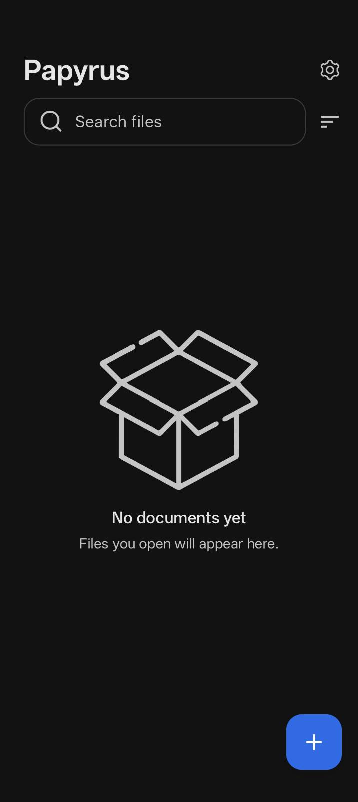
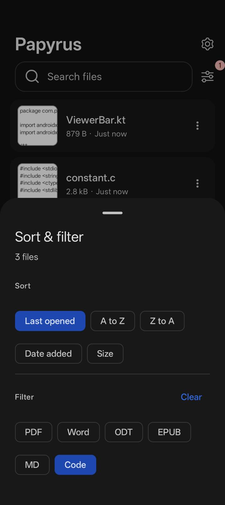
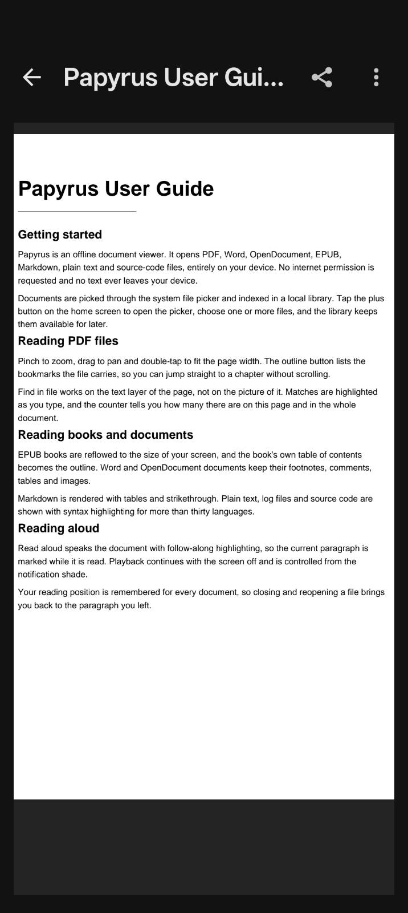
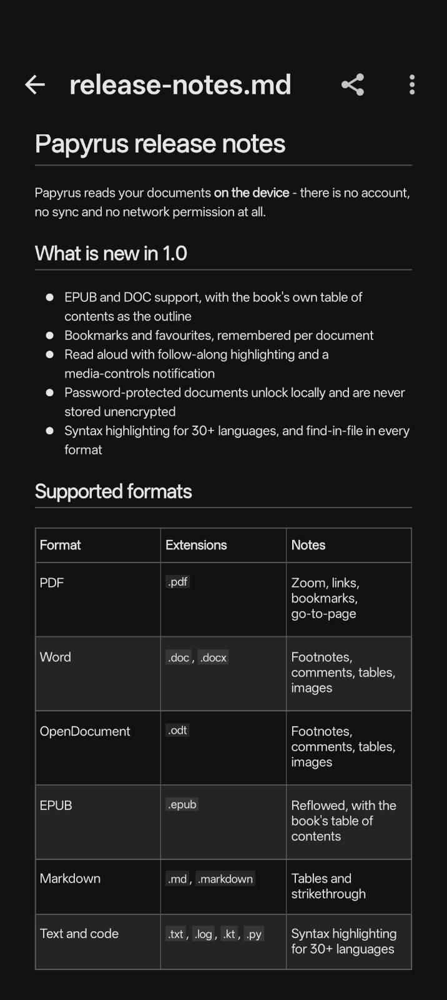
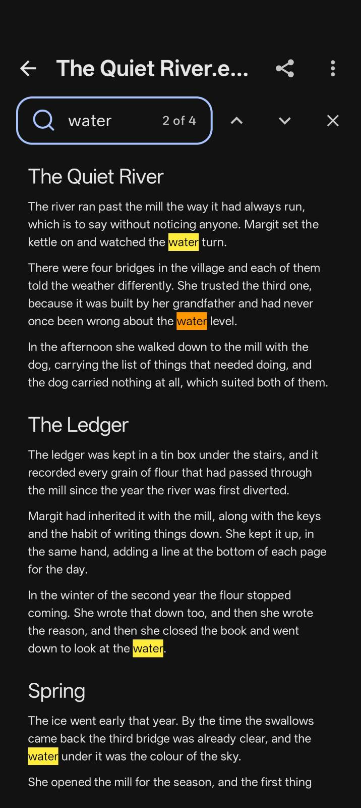
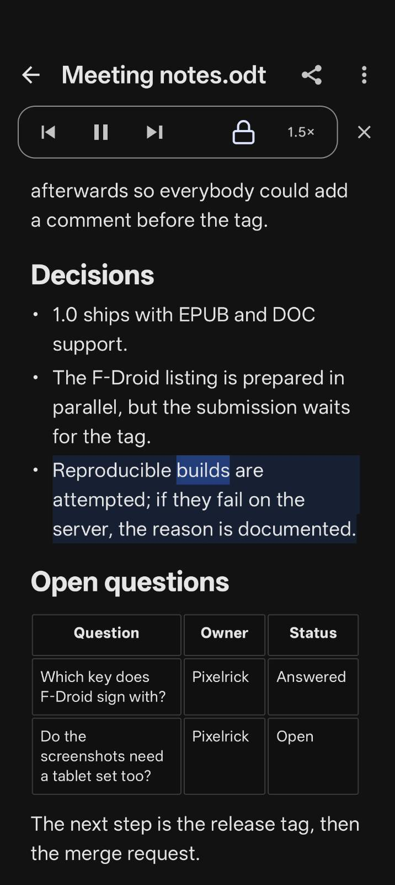
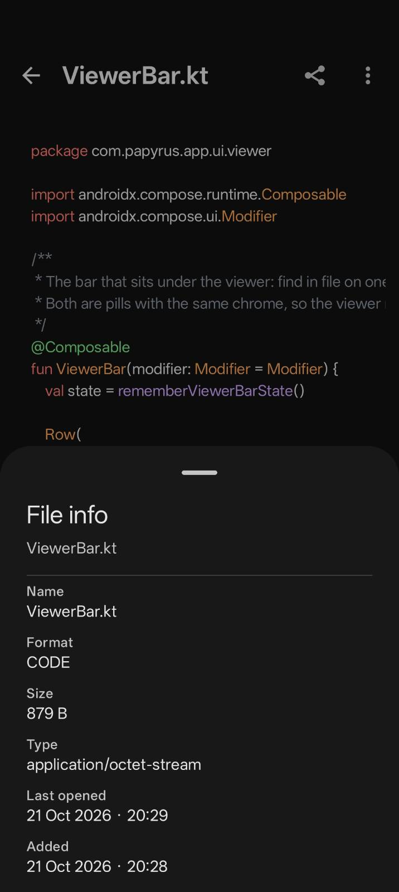
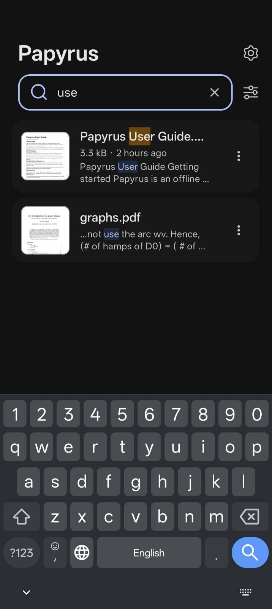
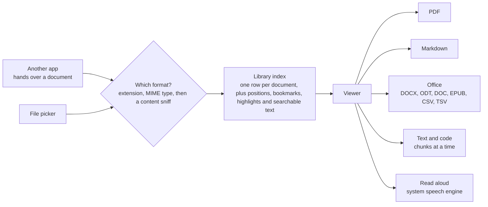
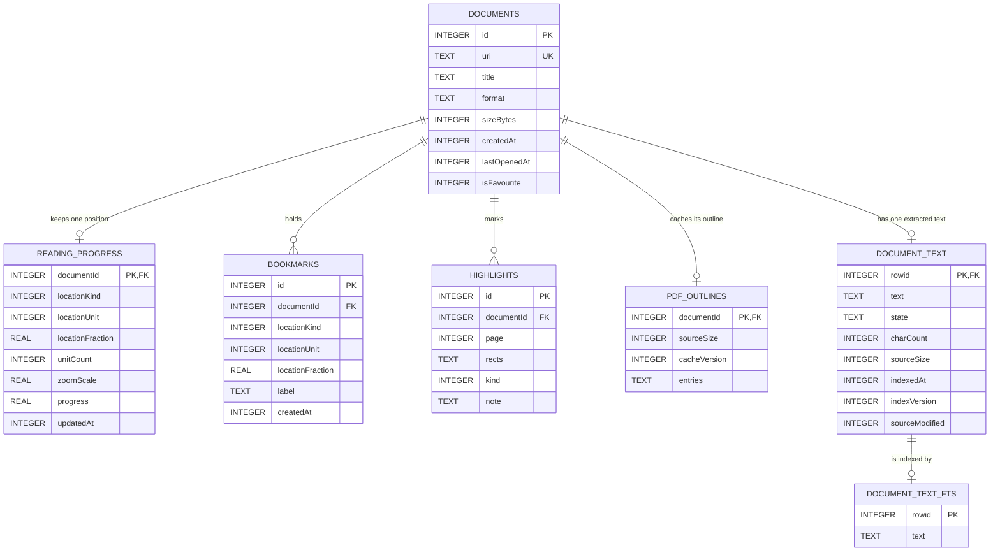

<p align="center">
  
</p>

<h1 align="center">Papyrus</h1>

<p align="center">
  <em>Offline document viewer for Android: PDF, Word, OpenDocument, EPUB, Markdown, text and code.</em><br>
  <sub>No internet permission. No ads. No accounts. No analytics.</sub>
</p>

<p align="center">
  <a href="https://github.com/Pixelrick420/Papyrus/actions/workflows/build.yml"></a>
  <a href="https://github.com/Pixelrick420/Papyrus/blob/main/LICENSE"></a>
  <a href="https://github.com/Pixelrick420/Papyrus/releases"></a>
  
</p>

<p align="center">
  <a href="#screenshots">Screenshots</a> ·
  <a href="#formats">Formats</a> ·
  <a href="#features">Features</a> ·
  <a href="#install">Install</a> ·
  <a href="#build">Build</a> ·
  <a href="#architecture">Architecture</a> ·
  <a href="#website">Website</a> ·
  <a href="#license">License</a>
</p>

## Screenshots

<table>
  <tr>
    <td align="center" valign="top">
      <br>
      <sub><b>Library</b><br>search, sort &amp; filter, starred files</sub>
    </td>
    <td align="center" valign="top">
      <br>
      <sub><b>Sort &amp; filter</b><br>one sheet, a live match count</sub>
    </td>
    <td align="center" valign="top">
      <br>
      <sub><b>PDF</b><br>zoom, links, outline, go to page</sub>
    </td>
    <td align="center" valign="top">
      <br>
      <sub><b>Markdown</b><br>tables, task lists, maths, code</sub>
    </td>
  </tr>
  <tr>
    <td align="center" valign="top">
      <br>
      <sub><b>Find in file</b><br>every format, Ctrl+F</sub>
    </td>
    <td align="center" valign="top">
      <br>
      <sub><b>Read aloud</b><br>sentence and word highlighting</sub>
    </td>
    <td align="center" valign="top">
      <br>
      <sub><b>File info</b><br>name, format, size, URI</sub>
    </td>
    <td align="center" valign="top">
      <br>
      <sub><b>Search</b><br>full-text content search</sub>
    </td>
  </tr>
</table>

## Why Papyrus

Offline document viewer for Android built with Kotlin, Jetpack Compose and Room.

Documents open through the Storage Access Framework, get indexed in a local Room database, and render entirely
on-device. The manifest declares no network or storage permissions; the only ones it asks for,
`FOREGROUND_SERVICE` and `FOREGROUND_SERVICE_MEDIA_PLAYBACK`, let read-aloud keep speaking with the screen off,
and `POST_NOTIFICATIONS` lets read-aloud show its playback notification (asked the first time read-aloud is used,
on Android 13 and up). A `<queries>` entry for the text-to-speech service lets read-aloud see the speech engine you
chose, since Android 11 and up hides other apps otherwise.

## Formats

| Format            | What you get                                                                                                  |
| ----------------- | ------------------------------------------------------------------------------------------------------------- |
| **PDF**           | Zoom, links, **Outline**, **Go to page**, text selection, highlights and notes, form filling, password unlock |
| **DOCX / ODT**    | Headings, lists, tables, images, footnotes, reviewer comments, DOCX equations as text                         |
| **DOC**           | Paragraphs and tables                                                                                         |
| **EPUB**          | A reflowed book, its own table of contents as the **Outline**, its cover as the thumbnail                     |
| **Markdown**      | Tables, task lists, maths, footnotes, autolinks, coloured code fences, `data:` URI images                     |
| **Text / Logs**   | Fixed-size chunks, selectable text, optional line numbers, no-wrap mode, hyphenated prose                     |
| **Code / Config** | The same text pipeline, with syntax colour for many languages, found by name or by content                    |
| **CSV / TSV**     | A header row in bold, wrapping cells, sideways scroll for wide tables                                         |

The format comes from the file extension first, then the MIME type, then a short content sniff. Text encodings are detected
automatically and can be changed from the viewer menu. A source file's language comes from its name too; only when the
name cannot place it (an unknown or missing extension, or `.h` and `.m`) is the start of the file read, for a shebang,
an XML root, JSON or Objective-C.

## Features

### Library

- **Search** filters the list by title as you type and also looks inside the documents. A document that matches by
  content shows an excerpt under its title, with the matching words highlighted. Every word must appear, though a
  single-character word is dropped when a longer one is typed, and a word matches by prefix, so `scal` finds "scaling".
  Content matches are limited to the most relevant documents, and the list keeps your chosen sort order. Opening a
  content match lands on the first occurrence of the first searchable word and holds a highlight on it briefly before
  it fades; where find cannot search the document, it opens at the saved position instead.
- **Sort & filter** is the slider icon beside the search pill. One sheet holds every sort order, every file-type
  filter and the starred filter, with a badge counting what is on and a live count of matching files.
- **Sort** by last opened, name (A to Z or Z to A), date added or size. Names sort the way a person reads them, so
  `file2` comes before `file10`, and the choice is remembered.
- **File-type filters** for PDF, Word, ODT, EPUB, Markdown, text, CSV, TSV and code, plus starred files. They combine
  with search and sorting, survive rotation, and a **Clear filters** button appears when nothing matches.
- **Star** a file from its row menu. Reopening it or re-granting access keeps the star.
- **Thumbnails** for every document, with the format label until one is ready.
- **Bulk select** on a long-press, then share the whole selection or remove it after a confirmation. A remove or a share
  that takes longer than a moment shows how far it has got ("Removing 3 of 12") and ends with one announcement. A
  single row's **Remove** can still be undone for a few seconds.
- **Tablets and foldables** show the library and a document side by side once the window is wide enough for two panes
  and tall enough that a phone on its side keeps one pane. Tapping a document opens it beside the list without
  moving the list's scroll position or search, and the open row is highlighted. Opened from outside (another app, a
  crash report) a document still fills the window.
- **Share** sends a read-only grant, so the receiving app cannot write, rename or delete the file.
- **Remove** with **Undo**. Your own file on disk is never touched.
- **File info**: name, format, size, provider type, page count for PDFs, both timestamps and the content URI.

### Reading

- **Find in file** (Ctrl+F) in every format, with the current match highlighted.
- **PDF outline and go to page** (Ctrl+G). The PDF's own bookmarks become a foldable **Outline**, and a long one starts
  folded. A long outline appears as it is read, and is cached, so the next open shows it at once.
- **Go to line** (Ctrl+G) in long text and code: type a line number to jump to it. It lands on the line exactly where
  lines do not wrap, and within its chunk where they do.
- **Scrub preview** in text and code: while the scroll knob is held, a readout beside it shows the line at the top of
  the screen and the first words of it.
- **Bookmarks** (Ctrl+D) in every format: named or positional, rename and delete with Undo, with a per-document cap.
- **PDF text selection**: long-press to select text, then tap **Copy** to put it on the clipboard. For a library file,
  **Highlight** also saves the selection, and on a selection that touches one, **Remove highlight** takes it off.
  Tap a stored highlight to write or edit its note; clearing the text and saving makes it a plain highlight again. A
  note keeps the highlighter wash, adds a rule and a dot, and lives in Papyrus. Highlights and notes are kept in
  Papyrus's own database, so the PDF itself is never changed.
  Where the device can write page annotations, **Save highlighted copy** writes the plain highlights into a new
  PDF through the system picker. The notes stay behind, since a saved copy carries highlights only.
- **PDF form fields**: a PDF with a fillable AcroForm offers **Form fields** in the menu. Each field shows its label,
  page, value and state; text and choice fields open a dialog, while check boxes and radio buttons switch on tap.
  Edits apply to the open document only: **Save a copy** writes a new file through the system picker and never
  changes the original. An XFA form offers no fields, and a signature field can be seen but not signed.
- **Reading position** reopens a document where you stopped, at the same zoom, even after a rotation. A switch in
  Settings turns it off.
- **Read aloud** speaks the page, chunk, block or paragraph, shades the sentence being read (and the word, where the
  engine reports timing), and keeps going with the screen off. It pauses for a call or another app's audio, and when
  headphones are unplugged; a short interruption resumes on its own. Play/pause, skip, lock, speed and close are on the bar.
  It is offered only when the document has selectable text; a document with nothing speakable hides it.
- **Zoom** with a pinch or a double-tap, across a bounded range.
- **Links** open on tap for `http`, `https`, `mailto` and `tel`. A PDF's internal link scrolls to its page.

### Accessibility

- **TalkBack-first controls.** Each control is one focus stop that says what it is and what a tap does: a row reads
  "Open", "Select" or "Deselect", a selected row reads as checked, and sheet titles are headings so TalkBack can jump
  between sections. Headings in Markdown, EPUB, DOCX and ODT documents are headings too, and an image with alt
  text reads it; an image without is skipped.
- **Live updates and touch targets.** The find-in-file counter announces each match change ("2 of 7") without moving
  focus, and interactive controls meet the 48dp minimum touch target.
- **Known limits.** With TalkBack running, a PDF page with a text layer is read as one stop per page — its page
  number and the page's own text — rather than line by line; a page with no text layer reads only its number. Use
  Android's accessibility zoom instead of pinch zoom, which TalkBack intercepts.
- The manual test script and the checks enforced by `AccessibilitySemanticsTest` are in
  [ACCESSIBILITY.md](ACCESSIBILITY.md).

### Opening documents

- **Open with** shows a document from another app without adding it to the library.
- **Save to library** keeps a copy, so it outlives the other app's grant.
- **Password-protected documents** unlock locally: Word, OpenDocument and PDF. The password is never stored or logged,
  and the temporary copy of a Word or OpenDocument file is deleted when you close it.
- **Lost access** keeps the page on screen and offers to re-pick the file, matching on name and format. A file that
  was moved or deleted offers the same.
- **Open errors** say what went wrong: an unsupported type, a protection Papyrus cannot unlock, or a damaged file.

### Settings

- **Theme** follows the system, or stays light or dark. It is applied before the first frame, so the app opens in the
  right scheme instead of flashing the other one.
- **Colorblind mode** swaps the theme colours for a colour-blind safe palette of blue, orange and teal.
- **Night mode** inverts PDF pages, so white paper reads black.
- **Syntax highlighting** colours comments, strings, keywords and numbers in source and config files.
- **Line numbers** adds a gutter beside plain text, logs and code.
- **Wrap long lines** wraps at the screen edge. Off, each line stays on one row and the view scrolls sideways.
- **Hyphenation** splits long words at syllables where a `.txt` file wraps. Logs and code are never hyphenated.
- **Pretty print structured files** indents JSON, XML, HTML and SVG as they open, at the chosen tab size. The stored
  file is never changed, and an oversized one opens as stored.
- **Tab size** sets the indent for pretty printing: 2, 3, 4 or 8 spaces.
- **Autosave external docs** adds a document another app hands over to the library as it opens. Off, the viewer's
  **Save to library** keeps a copy instead.
- **Autosave encrypted docs** does the same for password-protected PDF, Word and OpenDocument files. They stay
  encrypted and the password is never stored.
- **Remember reading position** reopens a library document where you stopped and shows progress on Home. Off, no
  position is read or written, and the stored ones apply again when it goes back on.
- **Search inside documents** lets the library be read in the background so search can find words inside it. Larger
  files are paused while you read and under battery saver; small files are read as soon as they join the library, as
  described under [Content search](#content-search). Off, nothing new is read, small files included, and what is
  already indexed stays searchable.
- **Crash Reports** lists local crash logs by date and size, lets you open one in the viewer (read only, share
  button only), and deletes one after a confirmation dialog. Reports are ACRA JSON stored in app storage and
  nothing leaves the device.
- **About** shows the version and links to release notes, source code, the Apache 2.0 license and the privacy policy.

### Privacy & safety

- **EPUB safety.** A book is a ZIP from someone else, so it is read with hard limits and never extracted to disk beyond
  its images. A zip-slip entry, an oversized archive or a decompression bomb fails the book, not the app, and DRM is
  refused. Word and OpenDocument files are ZIPs too and are read under the same limits on entries, size and
  compression ratio.
- **Crash reports** are JSON files in app storage, written by ACRA. Nothing leaves the device.
- **Highlights and notes** stay in Papyrus's private database, are removed with the document, and are never written
  into your file unless you save a copy. A saved copy carries plain highlights only; notes are not exported.

## Install

1. Download the signed APK that fits your phone from the
   [latest release](https://github.com/Pixelrick420/Papyrus/releases/latest): `app-arm64-v8a-release.apk` for most
   phones, `app-armeabi-v7a-release.apk` for older 32-bit ARM ones, or `app-universal-release.apk` if unsure or on an
   x86_64 device.
2. Install it; Android may ask you to allow installs from your browser or file manager.
3. Open a document from Papyrus, or tap one in another app and choose Papyrus.

Needs Android 8.0 or newer. No Play Services, no network permission, no account. To build it yourself, see
[Build](#build).

## Build

Needs a JDK, the Android SDK, and Android 8.0 or up. Use the JDK version CI pins in `.github/workflows/build.yml`.

| Task                            | What it does                                     |
| ------------------------------- | ------------------------------------------------ |
| `./gradlew assembleDebug`       | build the debug APKs                             |
| `./gradlew installLocalDebug`   | build and install on the connected device        |
| `./gradlew installLocalRelease` | minified release build, signed for local install |

Both install tasks use the universal APK. `installLocalRelease` signs a throwaway copy with the local debug keystore,
because the `release` build type is unsigned unless all four `PAPYRUS_*` signing properties are supplied. The build
fails outright if any configuration resolves a Google Play Services, Firebase, ML Kit, Play or data-transport
dependency, so F-Droid compliance is enforced rather than documented.

## Test

| Task                                                                    | What it runs                                       |
| ----------------------------------------------------------------------- | -------------------------------------------------- |
| `./gradlew check`                                                       | unit tests, lint and detekt                        |
| `./gradlew testDebugUnitTest`                                           | unit tests alone                                   |
| `./gradlew connectedDebugAndroidTest`                                   | semantics and end-to-end tests on a device         |

The semantics suite needs a device or emulator kept awake and unlocked; [ACCESSIBILITY.md](ACCESSIBILITY.md) covers
that and the manual TalkBack script.

The end-to-end tests are in `app/src/androidTest/java/com/papyrus/app/e2e`. They launch the installed app, hand it
documents the way a file manager does, and drive it through the accessibility tree with UI Automator, so they call
nothing inside the app. They run on `debug` only: minification makes AGP minify the androidTest APK too and treat the
app's output as a provided classpath, so anything R8 stripped from the app is missing at run time and the runner dies
before the first test — a green build reporting zero tests. Every test starts from a fresh install, so none
depends on another: `FreshInstall` empties the database, the imported copies and the settings before each
one, and `PapyrusTestRunner` takes the same data off disk before any of the app's code loads.

The emulator in CI draws in software, so a frame can arrive seconds late and a tap can be lost. Two things keep that from
failing the build. `RetryRule` runs a failed end-to-end test again (a fixed number of attempts, each from a fresh
install, with a cap on the whole run so a broken build still ends at a report), and logs `FLAKY` for any test that only
passed on a retry. Then the emulator job grades the suite as a whole instead of failing on the first red test: it passes
when at least a configured share of the tests passed (`EMULATOR_MIN_PASS_PERCENT`, 90, in `.github/workflows/build.yml`). Tests
that never ran count as not passing, and a run that reports no tests at all fails, so a crashed run cannot pass by
omission. The failing tests are listed in the job summary and as warnings, and `logcat.txt` is in the
`emulator-test-results` artifact. Locally, `./gradlew connectedDebugAndroidTest` stays strict: any failure fails it.

The DOCX/ODT, EPUB and DOC extractors run against archives the tests build in memory (kxml2 stands in for the platform's
`XmlPullParser`, and the `.doc` fixtures assemble the OLE2 container and piece table from scratch). detekt is scoped to
dead code and correctness, with the deliberate broad catches baselined so they stay visible. CI runs `check` (unit tests, lint
and detekt, with their reports uploaded as the `check-reports` artifact) and `assembleRelease` on every pull request to
`main`, and those plus the emulator suite on every push to `main`; a `v*` tag runs the unit tests and publishes the signed
release.

## Architecture

Papyrus gets a document one of two ways: you pick it in the system file picker, or another app hands one over. Either
way it works out the format and opens the viewer for it. A picked file also joins the library, with its reading
position and bookmarks. A document handed over by another app joins the library only when **Autosave external docs** is
on; otherwise it is not added and lives only while Papyrus runs. Read aloud uses the text the viewer already extracted.



### Data and schema

The index is one Room row per document: URI, title, format, size, and the added and last-opened timestamps. Page count
and MIME type are read live, so they are not stored.

Alongside `documents` sit the tables that hang off it: `reading_progress` (one position per document), `bookmarks`,
`highlights` (a row per highlighted run, with its boxes on the page and an optional kind and note), `pdf_outlines` (a
cache keyed by the file's size and the outline reader's cache version), and the content index: `document_text`, holding
each document's extracted text, its index state and the modified time the provider gave when the text was read, plus
`document_text_fts`, an FTS4 table that stores only the inverted index so no text is kept twice. Each child references
`documents(id)` with `ON DELETE CASCADE`, so deleting a document removes its rows. `documents` rows are never written with
`OnConflictStrategy.REPLACE`, because that deletes and reinserts, which would cascade the children away. Migrations are
plain SQL in `data/Migrations.kt`; every schema version is exported to `app/schemas/`, and a test fails if one is missing
or has no migration.

`document_text_fts` is not a child of `documents`: it follows `document_text` through triggers Room generates.



### Content search

A background indexer fills `document_text` for every document that has no text yet, in small batches, and runs
again whenever a document is added, removed or changes size. The database is its queue, so an interrupted pass simply
resumes. Text is extracted by the same readers the viewer uses, so a search and find-in-file see the same words. Each
document ends in one of four states: `INDEXED`, `FAILED` (the reader threw; never retried unless the file changes),
`SKIPPED` (encrypted, DRM-protected, or no reader for the format) or `TOO_LARGE` (the file is over the size cap and is
never opened). A long document is indexed only up to a character cap. Raising `SearchIndexer.INDEX_VERSION`
re-indexes everything.

Small files are the exception to the gate: a file at or below `SearchIndexer.EAGER_MAX_BYTES` is read as soon as it
joins the library, without the startup delay and without waiting for the gate, so also while a document is open or
battery saver is on. The setting is the one thing they do not bypass: with **Search inside documents** off they stay
unread, and turning it back on reads them right away. After the pass at startup, this one runs again only when a small
file joins the library or changes size; adding a larger file, removing a document, starring or opening one does not
wake it.

Only new or changed documents are read. A document is changed when the size the library records for it differs from
the one its text was read at, which is what opening a file again after an edit does, or when the provider reports
another last-modified time than the one stored with its text. The second check asks the provider for that one number
and never opens the file, and it runs once per process, starting with the first gated pass after the startup delay. A
row written before that column existed has no stored time and is checked by size only until it is read again.

The indexer works at low priority, on a thread of its own, one document at a time. For files above the eager
threshold, it pauses between two documents while a viewer is in the foreground, whether full screen or beside the
list, and while battery saver is on, and picks the queue up again when both end. Settings has a switch that turns
indexing off, small files included; documents already indexed stay searchable.

A query is split into words (anything that is not a letter or digit separates them, only the first few are kept, and
a single-character word is dropped when a longer one is present), each quoted for FTS4 so nothing typed can act as an
operator, and each of two or more characters matches by prefix. Search runs in two phases: the index finds the matching
documents and they are ranked with BM25, then excerpts are fetched for only the best few. The Home screen waits a short
debounce after the last keystroke before it queries, and a search that fails is reported once and shown as no content
matches.

## Known limitations

- DOC files carry paragraphs and tables only: no images, and headings arrive as plain paragraphs. Encrypted and Word
  6/95 files are rejected.
- Fixed-layout EPUB books keep one page boundary per page and the shape of a page-sized picture, but not absolutely
  positioned text, which is read in document order and reflows. A book's styles are read for bold, italic and text
  alignment only, through simple selectors (a type, an id and classes) and with every `.css` part merged into one
  sheet; colours, fonts and sizes stay the app's. SVG pictures are drawn once into a PNG from straight shapes only
  (rectangles, lines, polygons, circles and `M L H V Z` paths): curves, text, gradients, clipping and any transform
  but a translate are left out, and an SVG cover is not used as the book's thumbnail. Links between chapters and from
  the table of contents open the place they name; a link to a missing place says so. Right-to-left books (a `dir`
  attribute, or the spine's page progression) set paragraphs, lists and notes from the right, but a table keeps its
  left-to-right column order.
- Password-protected documents open when they are a PDF, a `.docx` (ECMA-376 Agile) or an `.odt` (ODF 1.2
  AES-256-CBC). Newer ODF 1.3 packages and the legacy binary schemes are reported as protected but not opened.
- A very large PDF is not read for an outline, because PdfBox would hold a second copy of it in memory next to the
  renderer's; an outline already cached from an earlier open is still shown.
- Filling a PDF form needs Android 12 or newer with the PDF SDK extension that exposes form widgets, and writing
  highlights into a saved copy needs a newer extension, built in from Android 17. Elsewhere the page still renders, and
  its text, find and selection fall back to PDFBox, but no **Form fields** menu is offered and highlights stay in
  Papyrus alone. An XFA form is never offered for filling, a signature field can be seen but not signed, and only a
  capped number of form fields are read.
- Notes are stored, drawn and read in Papyrus only. A saved copy of the PDF carries plain highlights, not notes.
- Markdown shows an image only when the document carries it as a `data:` URI; the app never touches the network, so
  every other image falls back to its alt text.
- A `data:image/svg+xml` image, in its base64 or its percent-escaped form, is drawn by the same SVG subset the EPUB
  reader uses: shapes, straight paths, fill and stroke, `viewBox` and plain `translate`. What the subset cannot draw is
  left out, an oversized drawing or one that is not well formed falls back to its alt text, and a script in one is never
  run.
- Markdown footnotes are gathered into a **Footnotes** list at the end of the document, numbered in the order they are
  first cited, and a tap on a marker or its way back scrolls there.
- CSV and TSV tables are not read aloud.
- Content search only finds text that is in the index. Encrypted and DRM-protected documents are not indexed, nor are
  files over the size cap, and a document is indexed only up to a character cap. A scanned PDF with no text layer is
  indexed as empty. A document is searchable by content only once the indexer has reached it, which can take a while on
  a large library and, for files above the eager threshold, does not happen while you read or under battery saver. With
  **Search inside documents** off it does not happen at all.
- Size and shape caps: Markdown and tables have their own limits. A table that hits a cap ends with the
  viewer's incomplete-document notice instead of failing.
- Plain text and code have no size cap in UTF-8 and the single-byte encodings: a large file is indexed once and decoded
  as it is scrolled to, a few chunks at a time. One in UTF-16 or a multi-byte East Asian encoding is held in memory and
  cut at a size cap, as is one the file provider will not open twice.

## Website

`web/` is the static landing page that ships separately from the Android app: SvelteKit with Tailwind CSS, built to
static files.

```bash
cd web
pnpm install
pnpm dev      # local preview
pnpm lint     # ESLint
pnpm check    # Svelte and TypeScript checks
pnpm build    # static output in web/build
```

`.github/workflows/web.yml` runs lint, type check and build on any change under `web/`. Its pinned Node and pnpm
versions are the ones to use locally, and `web/package.json` lists the scripts.

## Contributing

Issues and pull requests are welcome. Run `./gradlew check` before sending one: it runs the unit tests, lint and
detekt, the same task CI runs. The screenshots this README shows live in
`fastlane/metadata/android/en-US/images/`, so the store listing and the README stay in step when you update them.

## Releases

- Every pull request to `main` runs the unit tests and assembles the unsigned release APKs uploaded as a build
  artifact, so a broken build shows up before the merge. The emulator suite is left to the push to `main`, to keep
  runner cost down.
- Every push to `main` runs the unit tests and the emulator suite, and assembles the unsigned release APKs uploaded as
  a build artifact. Failing emulator tests are tolerated unless a configured share of the suite did not pass; see
  [Test](#test).
- Pushing a `v*` tag runs the unit tests and publishes three signed APKs (arm64-v8a, armeabi-v7a and universal) to
  [Releases](../../releases). It does not run the emulator suite, which belongs to the `main` push, and it refuses a
  tag that is not on `main`.
- The tag must match `versionName` in `app/build.gradle.kts`, and `versionCode` must exceed the previous release tag's,
  since that value alone orders the upgrades.
- The job fails if any APK comes out unsigned or carries the Android debug certificate.
- Signing uses a release keystore supplied from repository secrets, never committed to the repo. The job stops early
  if any of those secrets is missing rather than publishing an APK no one can upgrade to.

## License

[Apache-2.0](LICENSE)

Third-party components bundled with the app are listed in [NOTICE](NOTICE).
