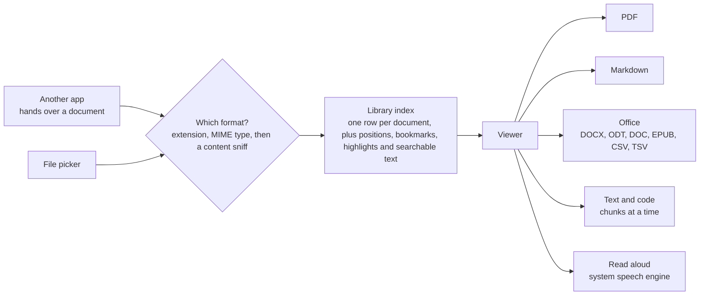
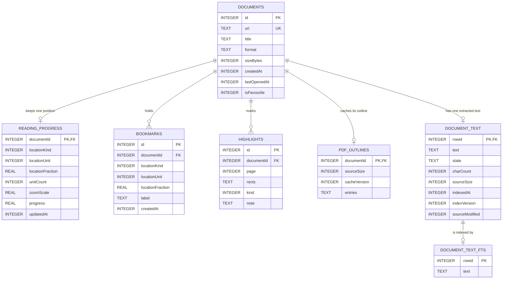

# Architecture

Papyrus is built with Kotlin, Jetpack Compose and Room.

Papyrus gets a document one of two ways: you pick it in the system file picker, or another app hands one over. Either
way it works out the format and opens the viewer for it. A picked file also joins the library, with its reading
position and bookmarks. A document handed over by another app joins the library only when **Autosave external docs** is
on; otherwise it is not added and lives only while Papyrus runs. Read aloud uses the text the viewer already extracted.

## Data and schema

The index is one Room row per document: URI, title, format, size, and the added and last-opened timestamps. Page count
and MIME type are read live, so they are not stored.

Alongside `documents` sit the tables that hang off it: `reading_progress` (one position per document), `bookmarks`,
`highlights` (a row per highlighted run, with its boxes on the page and an optional kind and note), `pdf_outlines` (a
cache keyed by the file's size and the outline reader's cache version), and the content index: `document_text`, holding
each document's extracted text, its index state and the modified time the provider gave when the text was read, plus
`document_text_fts`, an FTS4 table that stores only the inverted index so no text is kept twice. Each child references
`documents(id)` with `ON DELETE CASCADE`, so deleting a document removes its rows. `documents` rows are never written with
`OnConflictStrategy.REPLACE`, because that deletes and reinserts, which would cascade the children away. 1.0 starts the
schema at version 1: a 0.x database is never migrated or downgraded, it is deleted on first launch, and its imported
copies go with the orphan sweep. Every schema version is exported to `app/schemas/`.

`document_text_fts` is not a child of `documents`: it follows `document_text` through triggers Room generates.

## Content search

A background indexer fills `document_text` for every document that has no text yet, in small batches, and runs
again whenever a document is added, removed or changes size. The database is its queue, so an interrupted pass simply
resumes. Text is extracted by the same readers the viewer uses, so a search and find-in-file see the same words. Each
document ends in one of four states: `INDEXED`, `FAILED` (the reader threw; never retried unless the file changes),
`SKIPPED` (encrypted, DRM-protected, or no reader for the format) or `TOO_LARGE` (the file is over the size cap and is
never opened). A long document is indexed only up to a character cap. Raising `SearchIndexer.INDEX_VERSION`
re-indexes everything.

Small files are the exception to the gate: a file at or below `SearchIndexer.EAGER_MAX_BYTES` is read as soon as it
joins the library, without the startup delay and without waiting for the gate, so also while a document is open or
battery saver is on. The setting is the one thing they do not bypass: with **Search inside documents** off they stay
unread, and turning it back on reads them right away. After the pass at startup, this one runs again only when a small
file joins the library or changes size; adding a larger file, removing a document, starring or opening one does not
wake it.

Only new or changed documents are read. A document is changed when the size the library records for it differs from
the one its text was read at, which is what opening a file again after an edit does, or when the provider reports
another last-modified time than the one stored with its text. The second check asks the provider for that one number
and never opens the file, and it runs once per process, starting with the first gated pass after the startup delay. A
row written before that column existed has no stored time and is checked by size only until it is read again.

The indexer works at low priority, on a thread of its own, one document at a time. For files above the eager
threshold, it pauses between two documents while a viewer is in the foreground, whether full screen or beside the
list, and while battery saver is on, and picks the queue up again when both end. Settings has a switch that turns
indexing off, small files included; documents already indexed stay searchable.

A query is split into words (anything that is not a letter or digit separates them, only the first few are kept, and
a single-character word is dropped when a longer one is present), each quoted for FTS4 so nothing typed can act as an
operator, and each of two or more characters matches by prefix. Search runs in two phases: the index finds the matching
documents and they are ranked with BM25, then excerpts are fetched for only the best few. The Home screen waits a short
debounce after the last keystroke before it queries, and a search that fails is reported once and shown as no content
matches.

The caps and states above are described for readers in [LIMITATIONS.md](LIMITATIONS.md); the settings that control
them are in [SETTINGS.md](SETTINGS.md).
