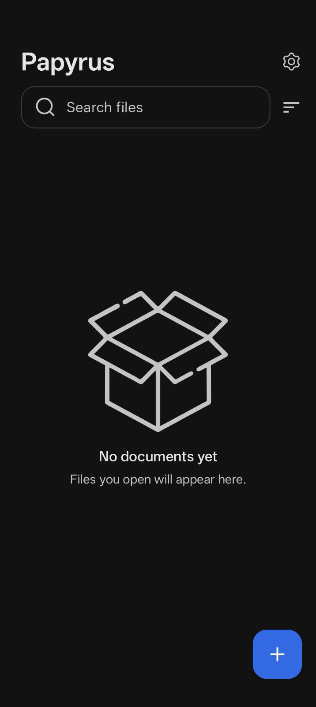
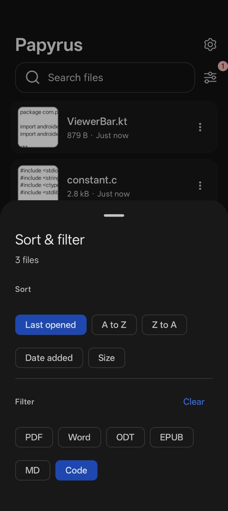
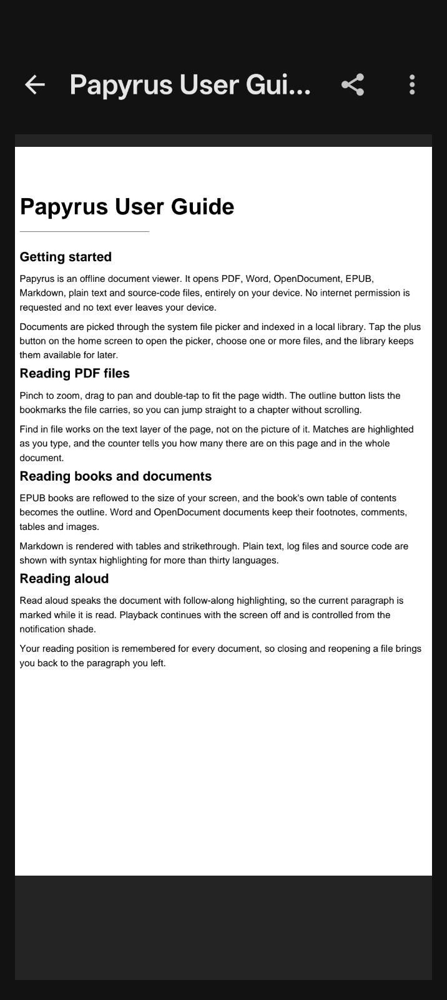
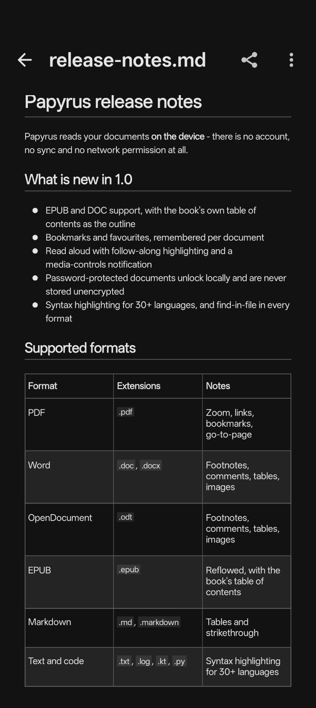
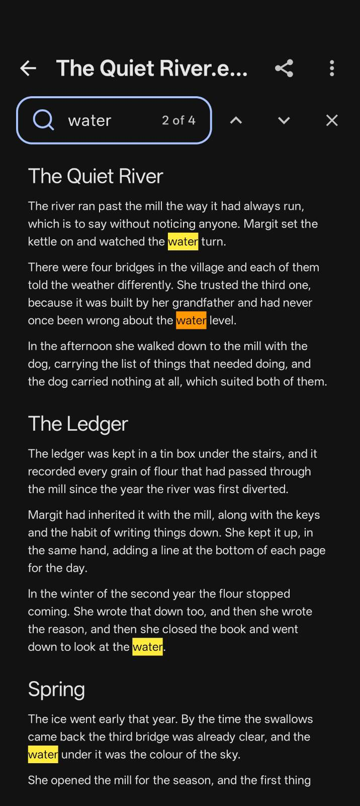
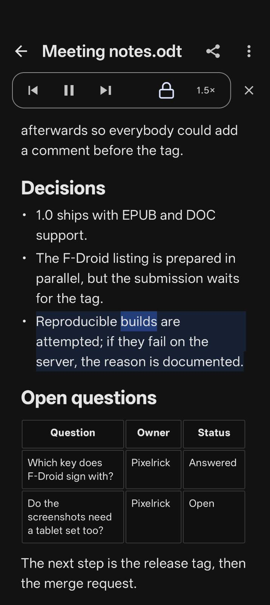
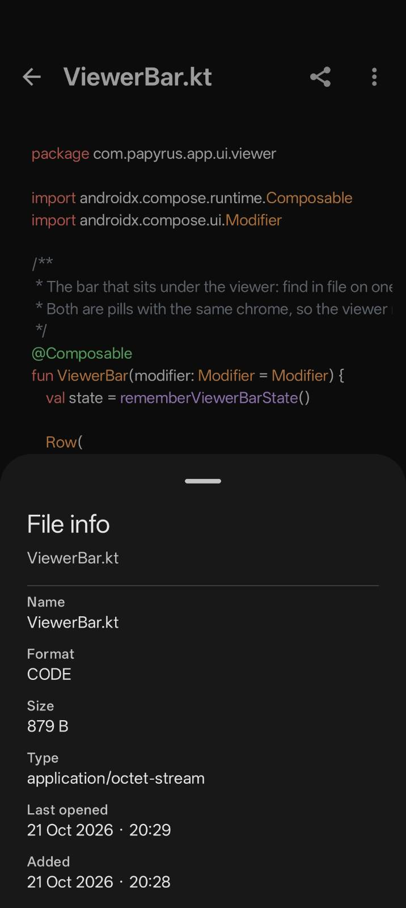
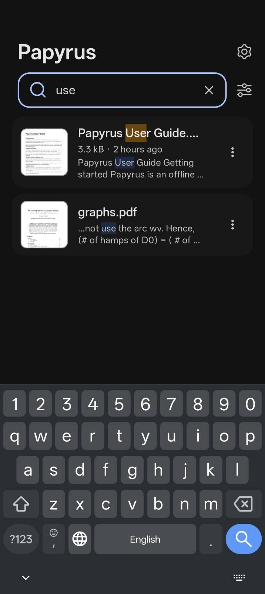

# Screenshots

All screenshots live in `fastlane/metadata/android/en-US/images/phoneScreenshots/`, so the store listing and the
documentation stay in step when they are updated.

<table>
  <tr>
    <td align="center" valign="top">
       
      <b>Library</b> search, sort &amp; filter, starred files
    </td>
    <td align="center" valign="top">
       
      <b>Sort &amp; filter</b> one sheet, a live match count
    </td>
    <td align="center" valign="top">
       
      <b>PDF</b> zoom, links, outline, go to page
    </td>
    <td align="center" valign="top">
       
      <b>Markdown</b> tables, task lists, maths, code
    </td>
  </tr>
  <tr>
    <td align="center" valign="top">
       
      <b>Find in file</b> every format, Ctrl+F
    </td>
    <td align="center" valign="top">
       
      <b>Read aloud</b> sentence and word highlighting
    </td>
    <td align="center" valign="top">
       
      <b>File info</b> name, format, size, URI
    </td>
    <td align="center" valign="top">
       
      <b>Search</b> full-text content search
    </td>
  </tr>
</table>
